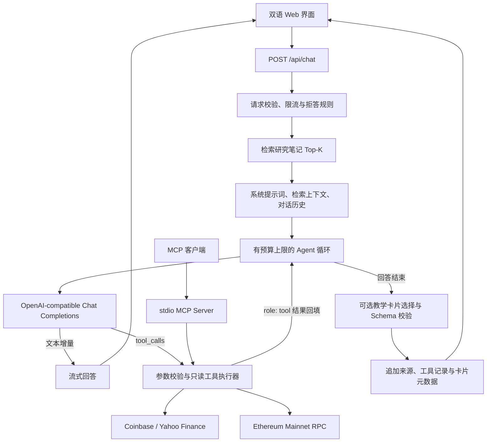

# omniAI · Financial Research Agent

**一个可运行、可追溯、可评测的金融研究 Agent：RAG 知识检索、多轮工具调用、结构化输出与 MCP 工具服务。**

A TypeScript research agent with retrieval-augmented generation, bounded tool calling, evidence traces, and a shared MCP tool server.

### [在线体验 Agent →](https://infent-agent.vercel.app/#live-agent)

[3D 交互演示](https://infent-agent.vercel.app/dashboard) · [产品介绍](https://infent-agent.vercel.app/) · [核心源码](lib/ai) · [评测集](eval/cases.json) · [CI 记录](https://github.com/ninglinLiu/infent-agent/actions/workflows/quality.yml)

`TypeScript` · `RAG` · `Function Calling` · `MCP` · `JSON Schema / Zod` · `Streaming` · `Next.js`

## 项目解决什么问题

投资研究问题经常需要两类依据：研究方法来自文档，价格与链上状态来自当前数据源。omniAI 将两者接入同一条对话链路：检索研究笔记，让模型按需调用只读工具，再把回答、检索来源和工具执行记录交给用户核对。

仓库名保留为 **`infent-agent`**，产品品牌为 **omniAI**。核心工程位于 [`lib/ai/`](lib/ai) 与 [`app/api/chat/route.ts`](app/api/chat/route.ts)；双语网站、研究工作台和 3D 街角提供可直接体验的产品界面。

## 两分钟体验

打开 [在线 Agent](https://infent-agent.vercel.app/#live-agent)，可以从三个问题开始：

| 提问示例 | 可以观察的能力 |
|---|---|
| 「如何判断一个回测是否过拟合？」 | 检索研究笔记、回答中的来源说明、参考资料列表 |
| 「现在 BTC 的价格是多少？请给出数据源和时间。」 | 模型发起 `get_price`，页面展示工具结果、来源与耗时 |
| 「跟单策略为什么往往难以复制？」 | 从方法论笔记中检索成本、容量与可复制性相关内容 |

也可以打开 [桌面 3D 演示](https://infent-agent.vercel.app/dashboard)：点击 **omniAI** 招牌进入研究工作台，点击 **学習室** 进入教学区域，门口 **ABOUT** 立牌打开产品介绍。工作台、学习室和宣传页均有「返回街角 / Back to street」入口。

在线模型与外部数据源可能出现额度、限流或网络错误；界面会明确显示未完成或不可用状态。

## 核心实现与源码导航

| 模块 | 已实现的工程能力 | 源码入口 |
|---|---|---|
| Agent 编排 | 模型 → 工具 → 结果回填 → 模型；最多 3 个工具轮次、6 次调用，预算耗尽后要求模型回答 | [`agent.ts`](lib/ai/agent.ts) |
| RAG | Markdown 切块、中文二元切分、IDF 加权检索、中英文术语扩展、相关性阈值；可选 embedding 检索 | [`retrieve.ts`](lib/ai/retrieve.ts) · [`build-knowledge.mjs`](scripts/build-knowledge.mjs) |
| 工具与证据 | 实时报价、以太坊主网只读查询；参数验证，记录来源、查询时间、结果与耗时 | [`tools.ts`](lib/ai/tools.ts) |
| 流式协议 | 解析上游 SSE、拼接跨分片 UTF-8 与工具参数；识别截断、空回答和不完整工具调用 | [`provider.ts`](lib/ai/provider.ts) |
| 结构化输出 | JSON Schema 约束教学策略卡选择，Zod、候选 ID 与去重校验；异常时规则降级 | [`structured.ts`](lib/ai/structured.ts) |
| MCP | 独立 stdio server，将同一套只读工具提供给支持 MCP 的客户端 | [`mcp-server.ts`](lib/ai/mcp-server.ts) |
| API 边界 | 请求体与消息校验、拒答规则、进程内限流、超时、取消生成、服务端密钥 | [`route.ts`](app/api/chat/route.ts) · [`policy.ts`](lib/ai/policy.ts) |
| 评测与回归 | 30 条标注问题、离线检索评测、可选真实模型评测、工具与 MCP 协议测试 | [`eval/`](eval) · [`tests/`](tests) |

**编排采用原生 TypeScript 实现，当前没有依赖 LangChain / LangGraph。** 模型协议、工具循环、检索与输出校验分别放在独立模块中，便于逐层阅读、测试和替换。

## 一次请求如何执行



检索在请求开始时执行，模型在后续循环中决定是否调用工具。上游使用 SSE；应用接口向前端返回文本流，并在末尾追加结构化元数据。参考资料来自检索结果，工具记录来自真实执行结果，二者在界面上分别展示。

### RAG：让小规模知识库可以复现

知识库是 [`content/knowledge/`](content/knowledge) 中的 **7 篇研究笔记、43 个切块**，主题包括预注册证伪、实盘复盘、成本与容量、前视偏差、跟单可复制性、风险预算及跨市场迁移。

1. **构建索引**：按 Markdown 标题和段落切分，保留文档名与小节元数据，合并过短片段，生成可随应用部署的 JSON 索引。
2. **默认检索**：英文按词、中文按二元组处理，结合次线性 TF、IDF、长度归一化和标题权重，默认取 Top-4。
3. **控制无关召回**：过滤高频词，要求至少命中两个不同的有效词，并设置相关性阈值；未命中时保持空上下文。有限的金融术语表用于英文问题到中文笔记的查询扩展。
4. **可选向量路径**：构建时计算 embedding 并以内容哈希缓存；运行时以余弦相似度检索。索引无向量或查询向量获取失败时使用词法检索。

几十个切块可以直接在内存中检索，因此当前无需独立向量数据库。扩大语料后，可继续评测召回质量，再引入重排、混合检索或外部索引。

### 工具调用：回答中的数据可以核对

| 工具 | 数据源与实现边界 |
|---|---|
| `get_price(symbol)` | BTC / ETH / SOL 使用 Coinbase spot；股票、ETF 使用 Yahoo Finance。返回币种、来源与时间信息，报价可能延迟。 |
| `get_onchain_stats(address)` | 校验 Ethereum mainnet，在同一区块哈希下读取原生 ETH 余额和 outgoing nonce；保留大整数精度，不推断代币持仓、收益或身份。 |

工具参数先经 Zod 校验，模型不能指定任意请求 URL。失败返回 `INVALID_ARGUMENTS`、`TIMEOUT` 或 `UNAVAILABLE` 等明确状态，不生成替代报价。每次执行保留名称、参数、结果和耗时；数据提供方时间与本系统查询时间分开记录。例如 Coinbase spot 不提供报价时间，`quotedAt` 为 `null`，`observedAt` 仅表示查询时间。

### 结构化输出：模型选择，服务端验证

模型只能从已有候选教学卡片中选择 ID 并给出理由。默认 `json_object` 模式将 Schema 放入提示词；支持严格 Schema 的模型可配置 `json_schema`。两种模式均在服务端校验字段、候选 ID 和重复项，失败则回退规则匹配，无候选时返回空列表。

教学卡片与模拟持仓沿用预设数据，模型不会生成可执行的真实交易订单。

## 评测与验证

[`eval/cases.json`](eval/cases.json) 包含 **30 条标注问题**，覆盖中英文研究问题、无关问题、拒答场景、行情和链上查询。评测脚本区分检索、规则路由和真实模型回答，避免用一个分数混淆不同能力。

2026-10-13 本地验证结果：

| 检查 | 结果 | 衡量什么 |
|---|---|---|
| 单元 / API / MCP / 学习状态测试 | 21 / 21 通过 | SSE 分片、工具循环与预算、参数、异常、同区块查询、结构化输出、MCP 协议与状态兼容性 |
| 离线评测 | 30 / 30 通过 | 无模型调用的检索与确定性拒答规则回归 |
| 正例预期文档命中 | 21 / 21 | 标注要求的文档是否出现在检索结果中 |
| 负例无研究引用 | 9 / 9 | 无关问题、拒答问题和纯数据查询不附带研究笔记 |
| 拒答规则路由 | 30 / 30 | 确定性规则是否符合评测标注 |
| TypeScript / ESLint / 生产构建 | 通过 | 类型、静态检查及 Next.js 构建 |

这套题参与了开发调试，属于小规模回归集；上述结果不代表独立测试集上的模型准确率、事实正确率或投资收益。真实模型评测另测请求成功与正文引用关键词出现，引用是否支撑结论仍需人工评审。历史真实模型验证见 [P1 验收记录](docs/P1_VERIFICATION.md)。

```bash
npm run typecheck
npm run lint
npm test
npm run eval          # 离线，不调用付费模型
npm run build
```

配置模型密钥后，可显式运行以下联网检查，会调用外部服务并可能消耗模型额度：

```bash
npm run eval:live     # 同一评测集 + 真实模型回答
npm run test:live     # 真实工具、模型工具调用与 JSON 选卡冒烟测试
```

报告输出到 `eval/results/`，默认不提交问答日志。[GitHub Actions](.github/workflows/quality.yml) 在 push / PR 时运行类型检查、lint、测试、离线评测和构建，保存评测 artifact；真实模型评测通过手动开关触发。

## 本地运行

需要 **Node.js 22** 和 npm。

```bash
git clone https://github.com/ninglinLiu/infent-agent.git
cd infent-agent
npm ci
```

将 [`.env.example`](.env.example) 复制为 `.env.local`，按已有供应商配置模型。默认示例使用 DeepSeek 的 OpenAI-compatible 接口：

```dotenv
LLM_API_KEY=your_server_side_key
LLM_BASE_URL=https://api.deepseek.com/v1
LLM_MODEL=deepseek-chat
LLM_STRUCTURED_OUTPUT=json_object
```

```bash
npm run build:knowledge
npm run dev
```

打开 [本地 Agent](http://localhost:3000/#live-agent) 或 [本地 3D 演示](http://localhost:3000/dashboard)。没有模型密钥也能运行前端、离线评测和测试；对话会明确提示配置缺失，不返回脚本伪造的模型回答。

| 配置 | 用途 |
|---|---|
| `LLM_API_KEY` / `LLM_BASE_URL` / `LLM_MODEL` | 服务端模型连接；供应商需支持所用的 tools / JSON 能力 |
| `LLM_MAX_TOKENS` / `LLM_TIMEOUT_MS` | 输出预算与请求超时 |
| `LLM_STRUCTURED_OUTPUT` | `json_object` 或 `json_schema`，均经服务端验证 |
| `ETH_RPC_URL` | 可选专用 Ethereum mainnet RPC；默认使用公共节点 |
| `EMBEDDING_API_KEY` / `EMBEDDING_BASE_URL` / `EMBEDDING_MODEL` | 可选向量检索配置 |

密钥只在服务端读取，不使用 `NEXT_PUBLIC_` 前缀，不提交 `.env.local`。

<details>
<summary>启用可选 embedding 检索</summary>

配置 `EMBEDDING_*` 后运行：

```bash
npm run build:knowledge -- --embed
```

运行时需要同一 embedding 模型与相应凭据。注意：默认 `npm run build` 会重新生成**词法索引**；部署向量版本时，应将构建命令改为 `npm run build:knowledge -- --embed && next build`，并在构建与运行环境中配置 embedding 参数。当前默认发布流程使用词法检索。

</details>

## MCP 接入

[`scripts/mcp-server.ts`](scripts/mcp-server.ts) 提供 stdio MCP 服务，与 Web Agent 共享 [`executeTool`](lib/ai/tools.ts)，无需模型密钥。两个工具都声明为只读，stdout 仅用于 MCP 协议。

```bash
npm run --silent mcp
```

<details>
<summary>Claude Desktop / Cursor 等 MCP 客户端配置示例</summary>

将绝对路径替换为本机仓库位置，先完成 `npm ci`：

```json
{
  "mcpServers": {
    "omniai-research": {
      "command": "node",
      "args": [
        "/ABSOLUTE/PATH/infent-agent/node_modules/tsx/dist/cli.mjs",
        "--tsconfig",
        "/ABSOLUTE/PATH/infent-agent/tsconfig.json",
        "/ABSOLUTE/PATH/infent-agent/scripts/mcp-server.ts"
      ],
      "env": {
        "ETH_RPC_URL": "https://ethereum-rpc.publicnode.com"
      }
    }
  }
}
```

Windows 路径可写成 `C:/Projects/infent-agent/...`。自动化测试使用真实 MCP 客户端验证 initialize、listTools、callTool，以及从仓库外启动 stdio 的路径解析。

</details>

## 产品展示与部署

- **双语宣传页**：产品定位与在线 Agent，和工作台共用 `/api/chat`。
- **研究工作台**：对话、工具证据与实时 K 线；持仓、策略执行和风险面板为教学模拟。
- **桌面 3D 街角**：React Three Fiber / Three.js 场景，支持旋转、缩放及实体招牌导航。
- **学习室**：导师序章、短课与剧情练习，中英文共用学习进度。

前端技术栈为 Next.js 14、React 18、Tailwind CSS 与 React Three Fiber。场景说明见 [雨夜入口](docs/NIGHT_STUDY.md) 和 [学习室](docs/ACADEMY_DEMO.md)。3D 街角按桌面体验开发；原展示页保留已有适配。

线上统一部署于 **[infent-agent.vercel.app](https://infent-agent.vercel.app/)**。部署使用 Next.js Node 服务端，聊天与行情 API 不支持纯静态 export。构建配置见 [`vercel.json`](vercel.json)；字体随依赖本地打包。PWA 仅缓存离线提示页，不缓存聊天、地址查询或行情；Vercel Analytics 需显式启用。

## 当前边界与后续方向

- **知识与评测规模**：当前是 7 篇笔记和 30 条开发回归题，后续需要独立测试集、引用支撑性检查与更大语料上的检索评测。
- **运行可靠性**：公共行情 / RPC 可能限流或延迟；IP 限流是进程内实现，多实例部署需要共享限流与额度管理。
- **Agent 状态**：客户端提交有限对话历史，当前没有服务端长期记忆、持久化任务队列或多 Agent 协作。
- **业务范围**：用于研究与教育；不连接券商、不下真实订单，也不将模拟绩效作为实盘业绩。

后续可围绕检索与重排、工具可观测性、持久化会话和更严格的评测体系继续迭代。当前已实现能力以源码、测试和上方演示为准。

本仓库是后续开发与展示的统一入口；[`infent1.0`](https://github.com/ninglinLiu/infent1.0) 保留早期课程提交历史。
